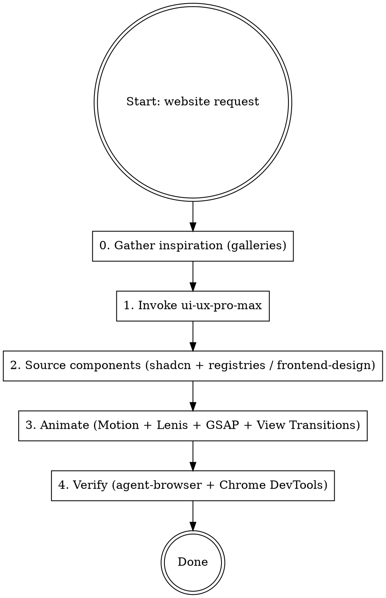

# Website Builder

Orchestrates design-intelligence and component tooling to produce **astounding, award-grade animated websites** — not generic AI pages.

| Layer | Tool | Role |
|-------|------|------|
| Inspiration | Awwwards · Godly · Land-book · SiteInspire (via `scraper` MCP) | Reference award-winning sites + steal motion ideas before designing |
| Design system | **`ui-ux-pro-max`** skill | Style, color, typography, UX rules, stack guidelines |
| Design contract | **DESIGN.md** — [spec](https://github.com/google-labs-code/design.md) + [73-file library](https://github.com/VoltAgent/awesome-design-md) | Freeze Step 1's decisions as tokens + rationale the agent re-reads every session |
| Components (primary) | **shadcn MCP** + free animated registries (**Aceternity · Magic UI · React Bits**) + **`frontend-design`** skill | Free, you-own-the-code components; distinctive non-generic UI |
| Components (logos only) | **21st.dev Magic MCP** (`magic`) | `logo_search` for brand SVGs; component generation is human-in-loop (Step 2) |
| Imagery | **`nano-banana-multi:image-gen`** skill | Hero / background / OG images |
| Copy | **`humanizer`** skill | Strip AI tells from headlines, body copy and CTAs |
| Animation | **Motion** (`motion.dev`) + **Lenis** + **GSAP** (free, ScrollTrigger/SplitText) + **View Transitions API** | The thing that makes it astounding |
| Motion judgment | This plugin's motion skills (Emil Kowalski, MIT): `find-animation-opportunities`, `animate`, `review-animations`, `animation-performance`, `improve-animations`, `animation-vocabulary`, `emil-design-eng`, `apple-design` | Decide what moves and what doesn't, build it right, review it before it ships |
| 3D | `nano-banana-multi:image-gen` (fal image-to-3D → GLB) + `gltf-transform` + `<model-viewer>` or React Three Fiber | Real products in 3D; immersive scenes only when they earn it |
| Docs grounding | **context7** — local cache first, MCP on miss | Version-correct Motion/GSAP/Tailwind/shadcn APIs (see Doc Grounding) |
| Design review | **Impeccable** (`/impeccable critique · audit · polish`) | 61 deterministic anti-slop detectors + design critique — catches the tells `ui-ux-pro-max` did not prevent |
| Verify | **agent-browser** CLI (functional/visual) + **Chrome DevTools** MCP (frame-rate/jank/CWV) | Confirm it works *and* holds 60fps |

**REQUIRED SUB-SKILL:** Always invoke `ui-ux-pro-max` at the start of every website build.

### Doc grounding (context7) — before writing any Motion / GSAP / Tailwind / shadcn / Next code

Animation APIs churn; never write them from memory. Follow this order:

1. **Local first** — check `/home/eze/projects/context7local/` for the `<tech>@<version>` snapshot and use it.
2. **MCP on miss/stale** — pull via the Context7 MCP only when the local snapshot is missing or out of date.
3. **Backfill** — after an MCP pull, write the immutable snapshot to `context7local/source/<tech>/<tech>-v<version>.md` and update `versions.lock` so next time is a local hit.

Already cached locally: `framer-motion 12.40` (= Motion), `tailwindcss 4.2`, `shadcn 4.6`, `nextjs 16`, `react 19`. **GSAP and Lenis are not cached yet** — first use seeds them via step 2→3.

**GSAP official skills (one-time):** GSAP is now 100% free incl. all plugins. Install the official agent skills so GSAP code is auto-grounded: `/plugin marketplace add greensock/gsap-skills`.

---

## Workflow



---

## Step 0 — Inspiration (design galleries)

Before locking a style, pull 2–4 reference sites that match the product's mood and **note their motion
techniques** (scroll behavior, reveal timing, hero treatment). None of these galleries have a public API
and all are JS-heavy with anti-bot, so use the **`scraper` MCP** (`scrape-url` / `extract-structured-data`
— stealth tier first, cloud fallback automatic). `agent-browser` is the fallback when you need to *see* the
live page; `WebFetch` will usually be blocked.

| Gallery | URL | Strongest for |
|---------|-----|---------------|
| **Awwwards** | `https://www.awwwards.com/websites/` | Cutting-edge visual craft, experimental animation, immersive storytelling |
| **Godly** | `https://godly.website/` | Hand-picked ~1000 best sites — exceptional scroll effects & motion |
| **Land-book** | `https://land-book.com/` | Landing pages & conversion patterns (updated daily) |
| **SiteInspire** | `https://www.siteinspire.com/` | Best filtering (style/type/subject/platform); editorial, minimal, typographic |

Rule of thumb: **Awwwards + Godly** for visual-craft / brand sites with bold motion; **Land-book +
SiteInspire** for conversion landing pages and clean production UI. Extract layout patterns, section order,
and motion ideas — feed them into Step 1, never copy pixel-for-pixel.

---

## Step 1 — Design System (ui-ux-pro-max)

Invoke the skill and run its search CLI to lock in design decisions **before** writing any code:

```bash
# Pick style
python3 ~/.claude/plugins/cache/ui-ux-pro-max-skill/ui-ux-pro-max/2.0.1/src/ui-ux-pro-max/scripts/search.py "<product type>" --domain product

# Pick color palette
python3 ~/.claude/plugins/cache/ui-ux-pro-max-skill/ui-ux-pro-max/2.0.1/src/ui-ux-pro-max/scripts/search.py "<style or mood>" --domain color

# Pick font pairing
python3 ~/.claude/plugins/cache/ui-ux-pro-max-skill/ui-ux-pro-max/2.0.1/src/ui-ux-pro-max/scripts/search.py "<style>" --domain typography

# Get stack-specific guidelines
python3 ~/.claude/plugins/cache/ui-ux-pro-max-skill/ui-ux-pro-max/2.0.1/src/ui-ux-pro-max/scripts/search.py "<topic>" --stack react
```

Lock in: `style`, `palette`, `font-pair`, `stack` before writing any component.

### Persist the decisions — `DESIGN.md`

Step 1's output dies with the session unless you write it down, and that is why section 12 of a long build
drifts away from section 1. Put the decisions in a root **`DESIGN.md`**: YAML front-matter tokens (colors,
typography, spacing, rounded) plus prose explaining *why* each value exists. It is the design equivalent of
`AGENTS.md` — a plain markdown file every coding agent re-reads on every later task, no Figma export and no
schema to configure.

```bash
# Start from a real design language, not a blank file — 73 DESIGN.md files reverse-engineered
# from shipped sites: https://github.com/VoltAgent/awesome-design-md
#   → copy the closest one to ./DESIGN.md, then adapt it to the Step 1 choices

npx @google/design.md lint DESIGN.md              # broken token refs + WCAG contrast, structured JSON, no LLM
npx @google/design.md diff DESIGN.md DESIGN-v2.md # after a redesign: prove you did not regress the system
```

`ui-ux-pro-max` *chooses* the design language; `DESIGN.md` is where that choice becomes binding. Write it
before Step 2 — every component you source or generate afterwards is judged against it, and the `lint`
contrast check is deterministic, so it catches the low-contrast-on-colored-background tell for free.

---

## Step 2 — Source Components

Prefer **components you own** over a metered generator. Search before hand-rolling boilerplate.

### Primary — shadcn MCP (free, MIT, zero-config)

Initialize once per project, then let the MCP install registry components:

```bash
pnpm dlx shadcn@latest mcp init --client claude   # zero-config; restart Claude Code after
```

Then prompt the MCP, e.g. *"Show me the components in the shadcn registry"*, *"add a pricing-table block"*.
Supports namespaced registries (`@registry/name`) so private/3rd-party component sets work too. You own
100% of the generated code — customize freely against the Step 1 design system.

### Free animated registries (pulled through the shadcn MCP — no extra MCP, no cap)

The distinctive, award-grade animated components are **free and unlimited** via shadcn-compatible
registries. Register the URL in `components.json`, then `npx shadcn add @<registry>/<component>` (or ask the
shadcn MCP). Use these for the "wow" sections instead of a metered generator:

| Registry | Best for |
|----------|----------|
| **Aceternity UI** | Bold hero / bento / parallax / glow sections — strong "designed in-house" feel |
| **Magic UI** | Motion-polished components (marquee, shimmer text, animated beams, borders) |
| **React Bits** | 500+ interactive effects and flourishes |

For bespoke, non-generic sections that no registry covers (custom heroes, unusual layouts) invoke the
**`frontend-design`** skill — distinctive, production-grade UI that avoids the generic AI look.

### Logos & quick variations — 21st.dev Magic MCP (`magic`)

21st's generated components trend generic and the tier is metered (≈100 credits/month free), so it is
**not** the component source — the free registries above are. Use it for two things only:

| Tool | When |
|------|------|
| `logo_search` | Brand / company logo SVGs — irreplaceable, low cost. Use freely. |
| `21st_magic_component_builder` | Only for a quick one-off variation. **Prefer human-in-loop:** point the user to `https://21st.dev/components`, let them pick, and paste it — rather than auto-spending credits. |

> **Auth:** the API key is read from the `MAGIC_API_KEY` env var (`API_KEY=${MAGIC_API_KEY}` in `.mcp.json`,
> value set in `~/.claude/settings.json`). Never inline a key — it lands in the public marketplace repo.

### Imagery — nano-banana

For hero images, backgrounds, illustrations, or OG/social cards, invoke the **`nano-banana-multi:image-gen`**
skill rather than placeholder stock.

### Copy — `humanizer`

A landing page reads as AI-generated from its words before its pixels: "Unlock the power of…", "In today's
fast-paced world…", three benefit cards that each say nothing. Award-grade motion wrapped around that copy
still reads as slop. Run headlines, body copy and CTAs through the **`humanizer`** skill — 25 catalogued AI
tells, rewritten without inventing facts (it asks rather than fabricating a missing number):

```
/humanizer

Rewrite the hero and pricing copy in src/app/page.tsx
```

When the client has real writing — an About page, a founder's posts — paste 2–3 paragraphs first and it
matches their voice instead of defaulting to neutral marketing register.

---

## Step 3 — Animate (Motion + Lenis + GSAP + View Transitions)

> **Naming:** Framer Motion became independent in 2025 and is now **Motion** (`motion.dev`).
> New projects use the `motion` package and `motion/react` import. `framer-motion` still works as a
> legacy alias if a project already depends on it.

Animation is what separates an astounding site from a templated one, and too much of it is what makes a
site feel cheap. Every animation needs a job: orient, give feedback, or connect two states. Motion on
something people use a hundred times a day (typing, navigation, toggles) gets none or stays under 150 ms.

**Decide before you build** (skills in this plugin; invoke by name):

| Situation | Skill |
|---|---|
| New page: where should anything move? | `website-builder:find-animation-opportunities` (proposes a few spots with exact values, rejects the rest) |
| Building one animation (curve, duration, CSS vs JS, interruptibility) | `website-builder:animate` |
| Existing site "feels cheap", too busy, or janky | `website-builder:improve-animations` (audit + prioritised plans) |
| The user describes an effect vaguely ("the bouncy thing") | `website-builder:animation-vocabulary` |
| Gesture-driven UI, springs, drag/swipe, sheets | `website-builder:apple-design` |
| Component polish beyond motion | `website-builder:emil-design-eng` |

Then build in three layers:
**(A) smooth scroll foundation → (B) scroll-linked storytelling → (C) micro-interaction polish.**

```bash
npm install motion lenis
```

### A. Smooth scroll foundation (Lenis)

Buttery inertial scroll is the single biggest "this feels premium" upgrade. Wrap the app once:

```tsx
import { ReactLenis } from "lenis/react";

export default function App({ children }) {
  return (
    <ReactLenis root options={{ lerp: 0.1, smoothWheel: true }}>
      {children}
    </ReactLenis>
  );
}
```

### B. Scroll-linked storytelling (the centerpiece)

**Parallax / scroll-progress transforms** — tie element motion to scroll position with `useScroll` +
`useTransform`. This drives parallax layers, progress bars, pinned reveals, horizontal scroll sections:

```tsx
import { motion, useScroll, useTransform } from "motion/react";
import { useRef } from "react";

function ParallaxHero() {
  const ref = useRef(null);
  const { scrollYProgress } = useScroll({ target: ref, offset: ["start start", "end start"] });
  const y = useTransform(scrollYProgress, [0, 1], ["0%", "40%"]);   // background drifts slower
  const opacity = useTransform(scrollYProgress, [0, 0.8], [1, 0]);  // content fades as you scroll past
  return (
    <section ref={ref} className="relative h-screen overflow-hidden">
      <motion.div style={{ y }} className="absolute inset-0 bg-[url(/hero.jpg)] bg-cover" />
      <motion.h1 style={{ opacity }} className="relative">…</motion.h1>
    </section>
  );
}
```

**Horizontal scroll section** (pinned, driven by vertical scroll):
```tsx
const { scrollYProgress } = useScroll({ target: ref });
const x = useTransform(scrollYProgress, [0, 1], ["0%", "-66%"]);
// <div ref={ref} className="h-[300vh]"> ... <motion.div style={{ x }} className="sticky top-0 flex">
```

**Staggered scroll reveals** — sections rise into view in sequence:
```tsx
const container = { hidden: {}, visible: { transition: { staggerChildren: 0.12 } } };
const item = { hidden: { opacity: 0, y: 24 }, visible: { opacity: 1, y: 0, transition: { duration: 0.6, ease: [0.23, 1, 0.32, 1] } } };

<motion.ul variants={container} initial="hidden" whileInView="visible" viewport={{ once: true, margin: "-80px" }}>
  {items.map((i) => <motion.li key={i.id} variants={item}>{i.label}</motion.li>)}
</motion.ul>
```

**Text reveal** — split a heading into words/lines and stagger them in for editorial impact:
```tsx
function RevealHeading({ text }) {
  const words = text.split(" ");
  return (
    <h2 aria-label={text}>
      {words.map((w, i) => (
        <span key={i} className="inline-block overflow-hidden">
          <motion.span className="inline-block"
            initial={{ y: "100%" }} whileInView={{ y: 0 }} viewport={{ once: true }}
            transition={{ delay: i * 0.05, duration: 0.6, ease: [0.23, 1, 0.32, 1] }}>
            {w}&nbsp;
          </motion.span>
        </span>
      ))}
    </h2>
  );
}
```

### C. Micro-interaction polish

**Spring hover + magnetic buttons** (springs feel alive; linear tweens feel cheap):
```tsx
<motion.button
  whileHover={{ scale: 1.04 }} whileTap={{ scale: 0.97 }}
  transition={{ type: "spring", stiffness: 400, damping: 17 }}>
  Get started
</motion.button>
```

**Page / route transitions** (`AnimatePresence` + shared-layout `layoutId` for morphing elements):
```tsx
<AnimatePresence mode="wait">
  <motion.main key={route}
    initial={{ opacity: 0, y: 12 }} animate={{ opacity: 1, y: 0 }} exit={{ opacity: 0, y: -12 }}
    transition={{ duration: 0.3, ease: [0.23, 1, 0.32, 1] }} />
</AnimatePresence>
```

**Layout animations** (height collapse, reorder, grid morphs): add the `layout` prop; share `layoutId`
across instances to morph between them (e.g. a card expanding into a modal).

### GSAP — scroll choreography, text & SVG (now 100% free)

After the Webflow acquisition GSAP is **fully free, including every former Club plugin** (ScrollTrigger,
SplitText, MorphSVG, DrawSVG, ScrollSmoother). Reach for it **alongside** Motion when the effect needs it:

- **ScrollTrigger** — complex scroll choreography: pinning, scrubbing, snap, multi-step timelines beyond
  what `useScroll` comfortably expresses.
- **SplitText** — production text reveals (lines/words/chars + masking) — cleaner than hand-splitting.
- **MorphSVG / DrawSVG** — path morphing and stroke-draw-on animations.

Role split: **Motion** = React component/gesture/layout state; **GSAP** = imperative timeline / scroll /
text / SVG. Ground GSAP via the official `gsap-skills` + context7 (it seeds the local cache on first use).
`npm install gsap` — all plugins are in the one package, no auth token.

### View Transitions API — native page/element transitions (free, zero-dep)

For route and same-page element transitions, prefer the **native View Transitions API** where supported
(same-document is Baseline as of late 2025). Next.js: `experimental.viewTransition` + React
`<ViewTransition>`; otherwise `document.startViewTransition(() => updateDOM())`. Progressive-enhance —
cross-document transitions are still Chromium/Safari only, so never make core navigation depend on them.

### 3D: product models and WebGL scenes

Two different jobs. Gate both behind explicit 3D intent.

**A real product the visitor can spin, zoom or place in AR**

1. **Get a model.** Ask first whether the client has a CAD export or GLB. If not, generate one with the
   `nano-banana-multi:image-gen` skill: fal image-to-3D, where Hunyuan 3D Pro takes front, back and side photos
   ($0.375, up to $0.825 with PBR, multi-view and custom face count). Its `references/fal-endpoints.md` has the
   options and prices.
2. **Check it against the photos.** Generators invent the hidden sides and smear printed labels. The client
   approves the model before it ships.
3. **Optimise it.** `npx @gltf-transform/cli optimize in.glb out.glb --compress meshopt --texture-compress webp`
   (CLI 4.5). Aim for ≤ 3 MB; add `--simplify true --simplify-ratio 0.5` if it is still heavy.
4. **Show it** with `<model-viewer>` (`@google/model-viewer` 4.4, a web component: no React or Three.js code):
   `camera-controls`, `auto-rotate`, a `poster` image for first paint, `loading="lazy"` below the fold, `ar`
   for phones.

**An immersive scene or hero**: React Three Fiber (`@react-three/fiber` + `drei`, `useGLTF` to load models)
or **Spline** for no-code scenes, only when it genuinely earns the bundle and the frame budget.

Either way: poster first (it is the LCP element), stop auto-rotation under `prefers-reduced-motion`, test at
375 px, and ground model-viewer / R3F / gltf-transform APIs in context7 before writing code.

### Animation Rules (non-negotiable)

The snippets in this file are starting points. Where they and this plugin's motion skills disagree (curve,
durations, transform shorthands, reduced motion, hover gating), the motion skills win: `animate` for building,
`review-animations` for judging.

| Rule | Value |
|------|-------|
| Micro-interaction duration | 150–300 ms |
| Page / section entrance | 400–700 ms |
| Signature easing | `cubic-bezier(0.23, 1, 0.32, 1)` (strong ease-out, the same curve the `animate` skill uses) or a spring for interactions; never the built-in `ease`/`easeOut` |
| Animate only | `transform` / `opacity` — never `width`/`height`/`top`/`left` directly (jank) |
| Scroll reveals | `viewport={{ once: true }}` — re-triggering on scroll-up is jarring |
| Reduced-motion | Always honor `useReducedMotion()` — required. Gentler, not zero: keep opacity, drop movement |
| Hover effects | Gate behind `@media (hover: hover) and (pointer: fine)` so touch screens don't get stuck hover states |
| Target | 60fps; profile with Chrome DevTools MCP in Step 4 if anything stutters |

**Reduced-motion guard (required):**
```tsx
import { useReducedMotion } from "motion/react";

function AnimatedSection({ children }) {
  const reduce = useReducedMotion();
  return (
    <motion.div
      initial={reduce ? { opacity: 0 } : { opacity: 0, y: 24 }}
      whileInView={{ opacity: 1, y: 0 }}
      viewport={{ once: true }}
      transition={{ duration: reduce ? 0.2 : 0.6, ease: [0.23, 1, 0.32, 1] }}
    >
      {children}
    </motion.div>
  );
}
```

---

## Step 4 — Verify

After building, run the dev server and verify on two distinct axes — **does it work** (agent-browser) and
**is it actually smooth** (Chrome DevTools).

**Functional / visual (`agent-browser`):** `open` the local dev server, then **`wait` for a real element**
(`open` returns before an SPA hydrates), then `snapshot -c -i` — never a bare `snapshot`, it dumps the whole
a11y tree into context. Use `screenshot` when the question is visual rather than structural. Confirm:
- Visual style matches the Step 1 design decisions and the Step 0 references
- Smooth scroll feels inertial (Lenis active), scroll-linked effects track the scrollbar
- Reveal/stagger animations fire once on entry, not on scroll-up
- Hover/tap springs respond; page transitions are clean (no flash/FOUC)
- Mobile viewport renders correctly (resize to 375px) and heavy scroll effects degrade gracefully
- `prefers-reduced-motion` disables non-essential motion

**Frame-rate / performance (Chrome DevTools MCP):** agent-browser confirms it *renders and works*; Chrome
DevTools confirms it's *actually smooth*. Record a performance trace while scrolling and check for **dropped
frames / long tasks**, plus Core Web Vitals (LCP / CLS / INP). Polish that runs at 30fps isn't polish — if
a scroll effect drops frames, the most common cause is animating a non-compositor property (see rules).
When the trace shows dropped frames, run `website-builder:animation-performance` on the offending effect.

**Motion review gate:** before calling the site done, run `website-builder:review-animations` on the
animation code. It defaults to flagging; fix what it flags or say why not.

**Design quality (`Impeccable`):** agent-browser proves it renders, Chrome DevTools proves it is smooth —
neither says it is *good*. Impeccable is a design-review vocabulary (24 commands) backed by **61 deterministic
detector rules** that run with no LLM and no API key, aimed at exactly the tells this skill exists to avoid:
Inter for everything, purple-to-blue gradients, cards nested in cards, gray text on colored backgrounds, the
rounded-square icon tile above every heading.

Already installed globally on this VM (`npx impeccable install -y --global`), so `/impeccable` and its
detector hooks (PostToolUse on Edit/Write, Stop deep pass — both no-ops outside UI files) are live. Run
`/impeccable init` once per new project to write `PRODUCT.md`; add `npx impeccable install --project` only
if you want a version-pinned copy inside the repo. The detectors also run standalone in CI — `detect` exits
2 when it finds anything:

```bash
npx impeccable detect src/app/page.tsx
```

```
/impeccable init                # one-time: records durable product truth in PRODUCT.md
/impeccable critique  <page>    # UX review: hierarchy, clarity, emotional resonance
/impeccable audit     <page>    # technical: a11y, performance, responsive
/impeccable polish    <page>    # final pass + design-system alignment
/impeccable bolder | quieter | typeset | layout | animate | distill   # targeted fixes
```

Impeccable grew out of Anthropic's `frontend-design` (Step 2), so treat it as the review half of that
pairing rather than a competitor to it. Fix what it flags, then re-run `critique` — never ship the first pass.

> Runs **headless** on this Linux VM — no Chrome install needed. Puppeteer auto-downloads chrome-for-testing
> on first run; pass `--headless=true`, or `--executablePath` pointing at agent-browser's private Chrome
> (`~/.agent-browser/browsers/chrome-*/chrome`) to skip the download. 🔴 Not `/opt/google/chrome/chrome`: on
> this VM it is a symlink to Microsoft Edge. The MCP is wired in this plugin's `.mcp.json` as `chrome-devtools`.

---

## Common Mistakes

| Mistake | Fix |
|---------|-----|
| Skipping the inspiration pass | Pull 2–4 gallery references in Step 0 — anchors design AND motion before code |
| Static page that "fades in" and stops | Add scroll-linked storytelling (parallax/pin/horizontal) — that's the astounding part |
| No smooth scroll | Add Lenis — biggest perceived-quality jump for least effort |
| Default linear easing everywhere | Use expo-out `[0.23, 1, 0.32, 1]` for reveals, springs for interactions |
| Using 21st.dev as the component source | Use the free shadcn registries (Aceternity / Magic UI / React Bits); 21st is `logo_search` + human-in-loop variations only |
| Writing Motion/GSAP/Tailwind from memory | Ground against the **local context7 cache first**, MCP on miss, then backfill — APIs churn |
| Importing from `framer-motion` in a new project | Use `motion` package / `motion/react` import |
| Animating `height`/`width`/`top`/`left` directly | Use `scaleY` + `overflow: hidden` or the `layout` prop |
| Forgetting `useReducedMotion` | Always add it — accessibility requirement |
| Skipping ui-ux-pro-max design phase | Produces inconsistent color/type choices — always run Step 1 |
| `staggerChildren` on large lists (50+ items) | Cap at ~20 visible items or use `AnimatePresence` + virtualization |
| Hand-rolling complex scroll/text effects in Motion | Use GSAP ScrollTrigger/SplitText (now free) for pinning, scrubbing, and masked text reveals |
| Reaching for Three.js by default | Motion + Lenis + GSAP cover ~95% of award-grade 2D work; add WebGL only for genuine 3D |
| Animating everything because the brief says "animated" | Run `find-animation-opportunities` first; most elements should not move |
| Shipping a generated GLB straight from the generator | Check it against the product photos, then `gltf-transform optimize`; 20 MB models kill LCP on phones |
| Declaring "smooth" without measuring | Profile with Chrome DevTools MCP — check dropped frames + CWV, don't eyeball it |
| Step 1 decisions living only in the chat | Write a root `DESIGN.md` (tokens + rationale) so section 12 still matches section 1 |
| Picking colors without a contrast check | `npx @google/design.md lint DESIGN.md` — deterministic WCAG check, no LLM in the loop |
| Shipping without a design critique | Run `/impeccable critique` + `audit`; agent-browser and DevTools verify *working* and *smooth*, never *good* |
| Award-grade visuals around "Unlock the power of…" copy | Run the copy through `humanizer` — the AI tells show in the words first |
